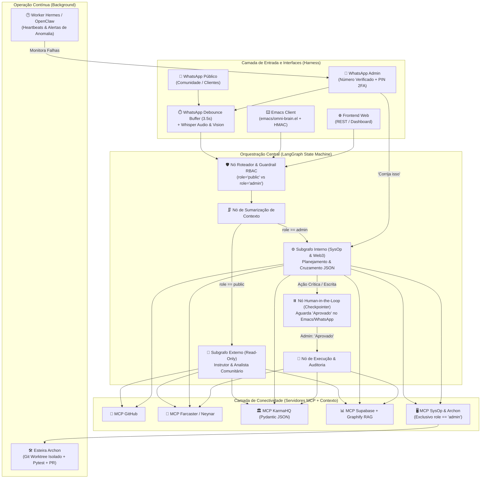

# 🧠 Omni Dual-Brain: Cérebro Único com Duas Fronteiras de Segurança

Implementação completa da arquitetura **"Cérebro Único com Duas Fronteiras de Segurança"** unificando **LangGraph**, **MCP (Model Context Protocol)**, **WhatsApp Harness (Debounce + Multimodal + RBAC Guardrails)**, **Emacs Client (`omni-brain.el`)**, **Conectores Web3/Social (GitHub, Farcaster/Neynar, KarmaHQ, Supabase/pgvector)** e **Operação Autônoma (Hermes Worker + Archon Worktree Auto-Fix)**.

---

## 🗺️ Topologia da Arquitetura Implementada



---

## 📂 Estrutura de Módulos

- **Configuração e Políticas RBAC:** [`src/omni_brain/config.py`](file:///home/sukata/omni-dual-brain/src/omni_brain/config.py)
- **Schemas Pydantic Determinísticos:** [`src/omni_brain/schemas/models.py`](file:///home/sukata/omni-dual-brain/src/omni_brain/schemas/models.py)
- **Harness do WhatsApp & Isolamento de Fronteiras:**
  - [`src/omni_brain/harness/rbac_guardrail.py`](file:///home/sukata/omni-dual-brain/src/omni_brain/harness/rbac_guardrail.py) — Isolamento estrito `public` vs `admin`, anti-Prompt Injection e sanitização de saída.
  - [`src/omni_brain/harness/debounce_buffer.py`](file:///home/sukata/omni-dual-brain/src/omni_brain/harness/debounce_buffer.py) — Fila de debounce (3.5s) para agrupar múltiplos balões consecutivos no WhatsApp.
  - [`src/omni_brain/harness/multimodal.py`](file:///home/sukata/omni-dual-brain/src/omni_brain/harness/multimodal.py) — Transcrição Whisper para áudios e descrição visual para imagens antes do grafo.
- **Engenharia de Contexto (Graphify + Supabase):**
  - [`src/omni_brain/context/graphify_indexer.py`](file:///home/sukata/omni-dual-brain/src/omni_brain/context/graphify_indexer.py) — Índice de código e documentação com busca híbrida por cosseno e decaimento cognitivo.
  - [`src/omni_brain/context/supabase_store.py`](file:///home/sukata/omni-dual-brain/src/omni_brain/context/supabase_store.py) & [`sql/001_supabase_schema.sql`](file:///home/sukata/omni-dual-brain/sql/001_supabase_schema.sql) — Snapshots relacionais, vetores `pgvector` e trilha de auditoria HITL.
- **Servidores MCP Modulares:**
  - [`src/omni_brain/mcp_servers/registry.py`](file:///home/sukata/omni-dual-brain/src/omni_brain/mcp_servers/registry.py) — Registro central com bloqueio por papel em nível de protocolo.
  - [`src/omni_brain/mcp_servers/github_mcp.py`](file:///home/sukata/omni-dual-brain/src/omni_brain/mcp_servers/github_mcp.py) — Status público, commits semanais e análise de PRs.
  - [`src/omni_brain/mcp_servers/neynar_mcp.py`](file:///home/sukata/omni-dual-brain/src/omni_brain/mcp_servers/neynar_mcp.py) — Métricas Farcaster, top casts por corações/likes e publicação.
  - [`src/omni_brain/mcp_servers/karmahq_mcp.py`](file:///home/sukata/omni-dual-brain/src/omni_brain/mcp_servers/karmahq_mcp.py) — Milestones de grants e construção determinística do JSON `KarmaHQMilestonePayload`.
  - [`src/omni_brain/mcp_servers/sysop_archon_mcp.py`](file:///home/sukata/omni-dual-brain/src/omni_brain/mcp_servers/sysop_archon_mcp.py) — Saúde de servidores, diagnósticos e esteira **Archon** (`git worktree` isolado).
- **Orquestração em Grafo (LangGraph + Checkpointer + HITL):**
  - [`src/omni_brain/graph/state.py`](file:///home/sukata/omni-dual-brain/src/omni_brain/graph/state.py)
  - [`src/omni_brain/graph/workflow.py`](file:///home/sukata/omni-dual-brain/src/omni_brain/graph/workflow.py)
- **Worker Proativo Hermes & API Unificada:**
  - [`src/omni_brain/workers/hermes_worker.py`](file:///home/sukata/omni-dual-brain/src/omni_brain/workers/hermes_worker.py)
  - [`src/omni_brain/api/server.py`](file:///home/sukata/omni-dual-brain/src/omni_brain/api/server.py)
- **Cliente Emacs (`omni-brain.el`) & Skills:**
  - [`emacs/omni-brain.el`](file:///home/sukata/omni-dual-brain/emacs/omni-brain.el)
  - [`skills/SKILL_WEB3_KARMAHQ.md`](file:///home/sukata/omni-dual-brain/skills/SKILL_WEB3_KARMAHQ.md)
  - [`skills/SKILL_SYSOP_ARCHON.md`](file:///home/sukata/omni-dual-brain/skills/SKILL_SYSOP_ARCHON.md)
  - [`skills/SKILL_COMMUNITY_INSTRUCTOR.md`](file:///home/sukata/omni-dual-brain/skills/SKILL_COMMUNITY_INSTRUCTOR.md)

---

## 🧪 Executando a Suíte de Testes

```bash
PYTHONPATH=src pytest -v tests/
```
